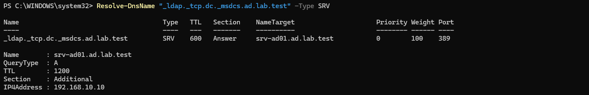
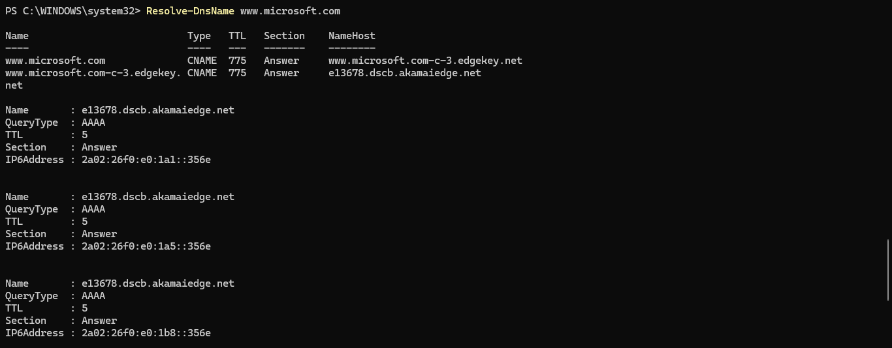

# Active Directory y DNS

## 1. Objetivo

Instalar y configurar Active Directory Domain Services (AD DS) en Windows Server 2025, creando un nuevo bosque y dominio para administrar de forma centralizada las identidades de una organización.

## 2. Entorno

- Hipervisor: Oracle VirtualBox
- Sistema operativo: Windows Server 2025 Standard Evaluation
- Servidor: SRV-AD01
- Red virtual: Lab-AD
- Red IPv4: 192.168.10.0/24
- Dirección IP estática: 192.168.10.10
- Puerta de enlace: 192.168.10.1
- Servidor DNS: 192.168.10.10

## 3. Dominio y bosque

Se instaló el rol Active Directory Domain Services y se promovió el servidor a controlador de dominio.

- Bosque: ad.lab.test
- Dominio: ad.lab.test
- Nombre NetBIOS: AD
- Controlador de dominio: SRV-AD01
- Nivel funcional del dominio: Windows Server 2025
- Catálogo global: habilitado

El laboratorio dispone actualmente de un único controlador de dominio.

## 4. Configuración DNS

Se instaló el servicio DNS junto con Active Directory.

Zonas principales:
- ad.lab.test
- _msdcs.ad.lab.test

Ambas zonas están integradas en Active Directory.

La tarjeta de red del controlador de dominio utiliza su propia dirección IP (192.168.10.10) como servidor DNS.

Reenviadores DNS configurados:
- 100.100.1.1
- 100.90.1.1

El servicio DNS utiliza estos reenviadores para resolver consultas externas.

## 5. DHCP y direccionamiento

La red NAT Lab-AD de VirtualBox mantiene habilitado su servidor DHCP.

Rango dinámico configurado:
- Inicio: 192.168.10.100
- Fin: 192.168.10.200

La dirección 192.168.10.10 está configurada estáticamente para el controlador de dominio.

El servicio DHCP todavía no se ha instalado en Windows Server.

## 6. Validación de servicios

Se comprobaron los siguientes servicios:

- NTDS: Servicios de dominio de Active Directory.
- DNS: Servidor DNS.
- Netlogon: Servicio de autenticación y registro de red.
- ADWS: Servicios web de Active Directory.

Todos devolvieron el estado Running.

También se verificó que el administrador puede iniciar sesión utilizando la cuenta del dominio:

- Cuenta: AD\administrador

## 7. Validación DNS

### Localización del controlador de dominio

Comando utilizado:

```powershell
Resolve-DnsName "_ldap._tcp.dc._msdcs.ad.lab.test" -Type SRV
```

Resultado:
- Registro SRV localizado correctamente.
- Servidor de destino: srv-ad01.ad.lab.test
- Puerto LDAP: 389
- Dirección IPv4: 192.168.10.10

Esta prueba confirma que DNS publica correctamente la información necesaria para localizar el servicio LDAP del controlador de dominio.

### Resolución DNS externa

Comando utilizado:

```powershell
Resolve-DnsName www.microsoft.com
```

Resultado: resolución correcta mediante registros CNAME y direcciones IP públicas.

Esta prueba confirma que el servidor DNS puede resolver nombres externos utilizando los reenviadores configurados.

## 8. Evidencias

### Resolución DNS interna



### Resolución DNS externa



## 9. Conclusiones

El servidor SRV-AD01 funciona como controlador de dominio y servidor DNS del bosque ad.lab.test.

Se ha verificado la autenticación del administrador del dominio, el estado de los servicios principales, la localización del controlador mediante registros SRV y la resolución de nombres externos.

La infraestructura básica de Active Directory y DNS está operativa.

## 10. Próximas prácticas

- Crear unidades organizativas (OU).
- Crear usuarios y grupos de seguridad.
- Incorporar un equipo cliente al dominio.
- Configurar directivas de grupo (GPO).
- Crear carpetas compartidas y administrar permisos SMB y NTFS.
- Simular y resolver incidencias de soporte IT.

