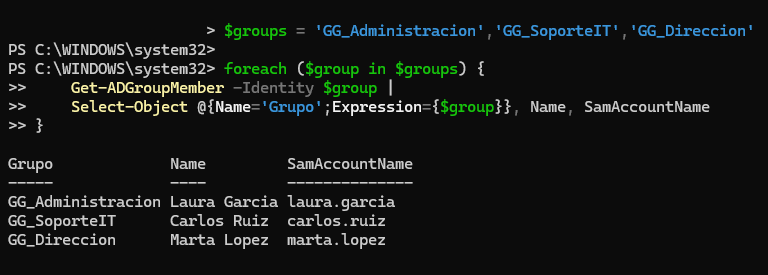

# Administración de usuarios y grupos en Active Directory

## 1. Objetivo

Organizar una empresa ficticia mediante unidades organizativas (OU), crear usuarios y grupos de seguridad y establecer una estructura básica de administración de identidades con Active Directory.

## 2. Estructura organizativa

Se creó la siguiente estructura dentro del dominio `ad.lab.test`:

```text
ad.lab.test
└── Empresa
    ├── Usuarios
    │   ├── Administracion
    │   ├── SoporteIT
    │   └── Direccion
    ├── Equipos
    └── Grupos
```

Las unidades organizativas permiten organizar los objetos del directorio, delegar tareas administrativas y aplicar directivas de grupo (GPO).

## 3. Usuarios creados

Se crearon tres cuentas de usuario ficticias, una por departamento.

| Nombre | Usuario | Unidad organizativa |
|---|---|---|
| Laura Garcia | laura.garcia | Administracion |
| Carlos Ruiz | carlos.ruiz | SoporteIT |
| Marta Lopez | marta.lopez | Direccion |

## 4. Grupos de seguridad

Se crearon tres grupos de seguridad:

| Grupo | Ámbito | Tipo |
|---|---|---|
| GG_Administracion | Global | Seguridad |
| GG_SoporteIT | Global | Seguridad |
| GG_Direccion | Global | Seguridad |

Los grupos permiten administrar permisos de forma centralizada, evitando asignarlos individualmente a cada usuario.

## 5. Asociación de usuarios a grupos

Se establecieron las siguientes pertenencias:

| Usuario | Grupo |
|---|---|
| laura.garcia | GG_Administracion |
| carlos.ruiz | GG_SoporteIT |
| marta.lopez | GG_Direccion |

## 6. Validación mediante PowerShell

Se utilizó PowerShell para consultar los miembros de los tres grupos.

Comandos utilizados:

```powershell
$groups = 'GG_Administracion','GG_SoporteIT','GG_Direccion'

foreach ($group in $groups) {
    Get-ADGroupMember -Identity $group |
    Select-Object @{Name='Grupo';Expression={$group}}, Name, SamAccountName
}
```

La consulta devolvió correctamente los tres usuarios y sus respectivos grupos.

## 7. Evidencias

### Comprobación de pertenencia a grupos



## 8. Conclusiones

Se ha creado una estructura organizativa básica para una empresa ficticia mediante Active Directory.

Los usuarios están organizados en unidades organizativas y asociados a grupos de seguridad globales según su departamento.

Se ha verificado mediante PowerShell que las asociaciones se han realizado correctamente.

Esta estructura servirá como base para configurar posteriormente permisos sobre carpetas compartidas y aplicar directivas de grupo.

## 9. Próximas prácticas

- Incorporar un equipo cliente al dominio.
- Aplicar una directiva de grupo (GPO).
- Crear carpetas compartidas mediante SMB.
- Configurar permisos NTFS y de uso compartido.
- Simular y resolver una incidencia de acceso a recursos.

